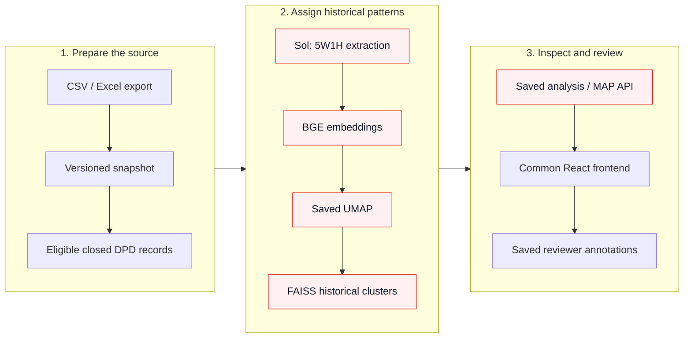

# CAPA.AI | MAP backend

**Find recurring patterns across historical deviations, then inspect the records behind each pattern.**

MAP is an independent FastAPI service. It reads an imported TrackWise export, extracts a consistent description of each event, and assigns records to existing historical clusters. The common React frontend uses its API to display clusters, original evidence and saved reviewer notes.

A deviation is a recorded departure from an expected process. CAPA means corrective and preventive action.

| At a glance | Details |
|---|---|
| Runtime | Docker supplies Python 3.11.18 and FastAPI |
| Local API | http://127.0.0.1:8101 |
| Interactive API docs | http://127.0.0.1:8101/docs |
| Docker image | `capa-ai-map:local` |
| Browser interface | Separate [common frontend](https://github.com/rahul-jha-tfs/capa-ai-frontend) |

[Architecture](#how-map-works) / [Setup](#run-locally) / [API](#use-the-api) / [Storage](#data-and-saved-work) / [Troubleshooting](#troubleshooting) / [Deployment](#deployment)

## Where this fits

CAPA.AI has four independent repositories. They communicate through HTTP; the old combined platform is not needed.

| Repository | Responsibility | Port |
|---|---|---|
| **This repository: MAP** | Group deviations into recurring patterns | 8101 |
| [MATCH backend](https://github.com/rahul-jha-tfs/capa-ai-match-backend) | Search for similar historical records | 8102 |
| [AUTHOR backend](https://github.com/rahul-jha-tfs/capa-ai-author-backend) | Support investigation and CAPA drafting | 8103 |
| [Common frontend](https://github.com/rahul-jha-tfs/capa-ai-frontend) | Browser interface; currently connected to MAP | 8100 |

The prototype uses CSV/XLSX exports instead of live TrackWise connectivity. Each backend owns a copy of the source snapshot. Matching snapshot IDs confirm the same source version; this is not one shared live database or automatic synchronization between services.

## How MAP works



In plain terms, GPT describes what happened, BGE makes descriptions comparable, and the saved models place them into historical groups. Running an analysis does not retrain those models.

5W1H means who, what, when, where, why and how. By default, eligibility selects closed DPD deviations with a deviation root record and a populated Description; the imported source can contain many other records.

The retained configuration uses **`gpt-6.1-sol`, `medium` reasoning**, and exactly three extraction inputs: **Description, Investigation and Conclusion**. BGE remains `BAAI/bge-large-en-v1.5`, producing 1,024-value vectors before UMAP. Additional source fields are not extra extraction inputs in this version.

MAP also provides saved analysis history, progress/cancellation, downloadable results, cluster-summary review, source browsing and record annotations. Source sections, dates, criticality and explicit CAPA relationships remain available for inspection.

**Reading the results:** similarity measures closeness to a historical cluster, not the probability that an assignment is correct. Cluster membership alone does not establish root cause, severity or product impact. A reviewer note does not change an assignment or update TrackWise.

The record review dataset also supplies the six saved 5W1H outputs (Who, What, When, Where, Why and How). The frontend shows them separately from the original source narrative. Opening a record reads the selected run; it does not regenerate output or incur a model call.

Close scores between the first and second cluster do not trigger `Needs review`. This applies to saved-run presentation and future pipelines. Future exports keep the legacy `close_assignment_review` column as `False` and leave its former threshold blank; raw similarity, score gap and assignments are preserved. Old run files are not rewritten, so their diagnostic close flags may still appear in raw downloads/results. Missing historical cluster descriptions and unassigned records retain specific warnings. No additional LLM explanation calls are made.

## Run locally

Use **Docker Desktop with its Linux engine running** and Git with access to this private repository. No host Python, virtual environment or pip installation is needed. Run the following from the MAP backend repository root in PowerShell:

```powershell
powershell -NoProfile -ExecutionPolicy Bypass -File .\Run-Map.ps1
```

On a fresh machine, first clone the repository into a short path, for example:

```powershell
git clone -c core.longpaths=true https://github.com/rahul-jha-tfs/capa-ai-map-backend.git
cd capa-ai-map-backend
powershell -NoProfile -ExecutionPolicy Bypass -File .\Run-Map.ps1
```

Skip cloning if the checkout is already present. Use a Git clone rather than GitHub's source ZIP: the source and models are delivered through Git LFS. The command retrieves missing files, including a verified portable Git LFS executable when necessary.

**What the command does:** checks Docker, retrieves source/models, builds the image with Python 3.11.18 and the pinned CPU dependencies, verifies all runtime checksums, imports the source, tests the real BGE/UMAP/FAISS path offline, starts the backend container, and runs **all eligible records** with live Sol extraction and live cluster summaries. Every Python step and the pipeline run inside Linux containers. Only Docker orchestration and repository downloads run on Windows.

The command creates `.env.docker` if needed. Configure your model endpoint and API key there, or enter them when prompted. The API-key prompt is hidden. Existing provider settings in `.env` are also recognised; Windows storage paths are not copied into the container. Credentials stay in ignored local files and are injected at runtime. A valid model endpoint/key, repository access and permitted network access remain prerequisites.

The first build/download needs several GB of disk space and can take time. Repeated launches reuse Docker layers, downloaded files and successful offline model checks. Model, extraction, eligibility and historical clustering behavior are unchanged.

| Command | Purpose |
|---|---|
| `.\Run-Map.ps1` | Prepare, start and run all eligible records. |
| `.\Run-Map.ps1 -Limit 5` | The same complete flow with a small live pilot. |
| `.\Run-Map.ps1 -PrepareOnly` | Build, import and test models without starting the backend or making paid calls. |
| `.\Run-Map.ps1 -ServeOnly` | Prepare and start the backend without submitting another analysis. |
| `.\Run-Map.ps1 -NewRun` | Explicitly start another analysis after the previous request finishes. |
| `.\Run-Map.ps1 -Stop` | Stop this managed container; refuse while an analysis is active. |
| `.\Run-Map.ps1 -Source "C:\data\export.xlsx" -Sheet "Sheet1"` | Use another source export; repeat the same source options on subsequent launches. |
| `.\Run-Map.ps1 -NonInteractive` | Require configured credentials rather than prompting. |

Visit http://127.0.0.1:8101/docs after startup. The backend remains running after the pipeline completes or the terminal closes. Source snapshots, analyses and annotations persist under the repository's `data` directory, mounted at `/data`. Restarting/replacing a container preserves that directory. The API serves the latest completed historical analysis to the frontend.

**Rerun the same command to recover.** It monitors the same active request or returns its completed result without repeating paid work. Failed/cancelled jobs retain their logs; after fixing the cause, use `-NewRun` to explicitly retry. This recovers the request, not a partially completed extraction stage after a worker crash. `limit: 0` means all records that pass the existing eligibility rules, not every source row.

An unrelated container is never replaced automatically. When a previous launcher already owns `capa-ai-map` or port 8101, use `-ContainerName capa-ai-map-demo -Port 18101` and update the frontend target. An alternate container name uses its own `.local/<container-name>/data` storage by default. Use `-DataDirectory` to choose another directory and `-EnvFile` for another local configuration. Independent MAP containers must use separate writable data directories. Keep the same options when resuming or stopping that installation. Logs are under `.local/<container-name>/setup.log`, `docker logs <container-name>`, and `data/map-runs/<run-id>/worker.log`.

`Setup-Map.ps1` and `Start-Map.ps1` have been removed: their roles are now covered by `Run-Map.ps1`. `Start-Docker.ps1` remains an advanced foreground launcher for an already prepared image/configuration, and `Run-Pipeline.ps1` remains useful for a separately deployed backend. A fresh installation needs only the main command above.

### Connect the frontend

Start MAP first. In a separate terminal, open the [frontend repo](https://github.com/rahul-jha-tfs/capa-ai-frontend):

```powershell
npm ci
npm run build
npm run start
```

Open http://127.0.0.1:8100/map. The frontend defaults to MAP on port 8101, including when MAP runs in Docker. MATCH and AUTHOR are not required for MAP screens.

## Configuration

The Docker setup reads `.env.docker` and generates an ignored container runtime file under `.local`. Templates contain configuration names, not credentials.

| Setting | Purpose |
|---|---|
| `CAPA_SOURCE_SNAPSHOT`, `CAPA_SOURCE_CSV` | Imported SQLite snapshot and its matching CSV export |
| `CAPA_DATA_DIR` | Writable root for analysis output and review history |
| `MAP_ASSETS_DIR` | Trusted UMAP/FAISS bundle |
| `HF_HOME` | Hugging Face cache containing BGE |
| `OPENAI_MODEL`, `OPENAI_REASONING_EFFORT` | Retained settings: `gpt-6.1-sol`, `medium` |
| `OPENAI_BASE_URL`, `OPENAI_API_KEY` | Model endpoint and credential; Azure transport is also supported through its endpoint/version settings |
| `MAP_DASHBOARD_RUN_ID` | Optional completed run to display; blank selects the latest completed historical analysis |

Viewing a saved result requires no new model call. Extraction and live summary generation send narrative text to the configured endpoint and consume its API allowance.

## Use the API

Open `/docs` for schemas and **Try it out**. The machine-readable schema is `/openapi.json`.

### Run the pipeline against an already running backend

For an already deployed backend, use this optional remote runner. The main `Run-Map.ps1` command already starts and monitors a pipeline; do not run both for the same new analysis. In another PowerShell terminal:

```powershell
.\Run-Pipeline.ps1
```

This submits **all eligible source records** (`limit: 0`) using the existing MAP filters, live extraction and live summaries. It monitors progress, prints result/download links when completed and reports failed or cancelled runs. Files are saved by the backend under `CAPA_DATA_DIR/map-runs/<run_id>/`; Docker's standard data mount keeps them in the repository's host `data` folder.

For a smaller test, another backend address or resuming the monitor for an existing run:

```powershell
.\Run-Pipeline.ps1 -Limit 40
.\Run-Pipeline.ps1 -ApiUrl http://127.0.0.1:18101
.\Run-Pipeline.ps1 -RunId "YOUR_RUN_ID"
```

Stopping the monitor with Ctrl+C leaves the backend job running. Replace `YOUR_RUN_ID` with its printed run ID to resume monitoring rather than submitting another run. If the frontend is pinned to an older `MAP_DASHBOARD_RUN_ID`, update or clear that setting and restart MAP to display the new analysis.

### Submit a run directly through the API

Create a small analysis using normal live summaries:

```powershell
$body = @{ limit = 5; summary_mode = "live" } | ConvertTo-Json
$run = Invoke-RestMethod -Method Post `
  -Uri "http://127.0.0.1:8101/api/v1/map/runs" `
  -ContentType "application/json" -Body $body

Invoke-RestMethod "http://127.0.0.1:8101/api/v1/map/runs/$($run.run_id)"
```

Poll until `completed`, then inspect that run's `/dataset`, `/results` or download. `limit: 0` selects all eligible records; use a small selection when checking a new setup. Failed runs retain status and a worker log.

**Complete API inventory: 21 method-and-path operations, checked against this service's generated OpenAPI schema.** Each row links to its request parameters, response, saved changes and errors in the [detailed API reference](docs/API.md). GET and POST on the same URL count separately.

### Service and source APIs

| Method and path | Function |
|---|---|
| [`GET /api/v1/map/health`](docs/API.md#get-api-v1-map-health) | Check that the API process responds. |
| [`GET /api/v1/map/ready`](docs/API.md#get-api-v1-map-ready) | Check that the configured source snapshot is available. |
| [`GET /api/v1/map/source`](docs/API.md#get-api-v1-map-source) | Inspect which source export this instance uses. |
| [`GET /api/v1/map/source/quarantine`](docs/API.md#get-api-v1-map-source-quarantine) | Inspect source rows held aside during import, for example duplicate IDs. |
| [`GET /api/v1/map/records`](docs/API.md#get-api-v1-map-records) | Browse accepted records in the imported source. |
| [`GET /api/v1/map/records/{pr_id}`](docs/API.md#get-api-v1-map-records-pr-id) | Open an accepted source record by its original PR ID. |

### Analysis APIs

| Method and path | Function |
|---|---|
| [`GET /api/v1/map/options`](docs/API.md#get-api-v1-map-options) | Discover run defaults, limits and supported choices before building a form. |
| [`GET /api/v1/map/runs/legacy-catalog`](docs/API.md#get-api-v1-map-runs-legacy-catalog) | List retained validation runs that can be imported. |
| [`POST /api/v1/map/runs/import-legacy`](docs/API.md#post-api-v1-map-runs-import-legacy) | Copy retained validation artifacts into this service's run history. |
| [`GET /api/v1/map/runs`](docs/API.md#get-api-v1-map-runs) | List the most recent analyses. |
| [`POST /api/v1/map/runs`](docs/API.md#post-api-v1-map-runs) | Queue a new extraction and clustering analysis. |
| [`GET /api/v1/map/runs/{run_id}`](docs/API.md#get-api-v1-map-runs-run-id) | Poll one analysis and inspect progress or failure details. |
| [`POST /api/v1/map/runs/{run_id}/cancel`](docs/API.md#post-api-v1-map-runs-run-id-cancel) | Stop a queued or running analysis. |

### Read results and downloads

| Method and path | Function |
|---|---|
| [`GET /api/v1/map/runs/{run_id}/results`](docs/API.md#get-api-v1-map-runs-run-id-results) | Inspect analysis records, cluster summaries and diagnostics. |
| [`GET /api/v1/map/runs/{run_id}/explorer`](docs/API.md#get-api-v1-map-runs-run-id-explorer) | Read the same explorer result through its alternate route. |
| [`GET /api/v1/map/runs/{run_id}/dataset`](docs/API.md#get-api-v1-map-runs-run-id-dataset) | Load one completed analysis in the frontend presentation format. |
| [`GET /map/dataset`](docs/API.md#get-map-dataset) | Load the analysis selected for the current MAP dashboard. |
| [`GET /api/v1/map/runs/{run_id}/download`](docs/API.md#get-api-v1-map-runs-run-id-download) | Download a retained artifact selected by kind. |

### Save reviews

| Method and path | Function |
|---|---|
| [`POST /api/v1/map/runs/{run_id}/review`](docs/API.md#post-api-v1-map-runs-run-id-review) | Save cluster-summary review decisions for a completed run. |
| [`GET /api/v1/map/runs/{run_id}/annotations`](docs/API.md#get-api-v1-map-runs-run-id-annotations) | Read saved record-level reviewer assessments and notes. |
| [`PUT /api/v1/map/runs/{run_id}/records/{record_id}/annotation`](docs/API.md#put-api-v1-map-runs-run-id-records-record-id-annotation) | Save one record's assessment/note with revision checking. |

Annotation writes contain `assessment`, `note` and `expected_revision`; zero means no prior annotation. HTTP **409** rejects a stale revision. Reload before retrying. Record annotations are separate from cluster-summary approvals.

The dataset's `sourceSections` contains explicit `{key, label, text}` entries. Clients can preserve original field boundaries without guessing from headings within the narrative.

## Data and saved work

The reference workstation has **19,643 accepted source records**; its latest dashboard analysis contains **1,000 records in 64 clusters**. These are local coverage figures, not application limits or saved results supplied by a clone. See [source provenance](data/sources/README.md).

| Location | Contents | In Git? |
|---|---|---|
| `data/sources/trackwise_records.csv` | Named source export | Yes, Git LFS |
| `data/sources/<snapshot-id>.sqlite3` and `.csv` | Imported source version and matching export | No |
| `data/assets/`, pinned BGE files under `data/models/` | Clustering bundle, reference files and exact BGE revision | Yes; large files use Git LFS |
| `data/map-runs/<run-id>/` | Request, progress, extraction, assignments, summaries, validation and logs | No |
| Run folder's `record_annotations.json` | Notes, revisions and annotation history | No |

Persist and back up complete run folders with the source versions needed to interpret them. Old analyses remain tied to their original source identity when new data is imported.

## Find your way around

```text
src/capa_map/              FastAPI routes and service-owned application logic
  application/            Runs, dataset assembly and record annotations
  infrastructure/         Source import, storage and HTTP boundary
src/map_core/             Retained extraction, embedding and clustering logic
src/map_pipeline.py       Pipeline stage orchestration
src/run_map.py            Persisted-model compatibility/parity helpers
tests/                    Offline contracts and runtime checks
Run-Map.ps1               Docker setup, startup and pipeline entry point
Start-Docker.ps1          Independent Docker launcher
```

## Verify your setup

```powershell
docker exec capa-ai-map python -m pip check
Invoke-RestMethod "http://127.0.0.1:8101/api/v1/map/ready"
```

For Docker, use `docker logs capa-ai-map` and the checks in [DOCKER.md](DOCKER.md). A healthy API alone does not establish model readiness; complete a small analysis too.

[VERIFICATION.md](VERIFICATION.md) records actual checks and their limits: Linux execution, persistence, frontend connectivity and agreement with the existing 500-record native baseline. Compatibility checks are not an independent accuracy evaluation.

## Troubleshooting

| Symptom | Check |
|---|---|
| No matching distribution for `soupsieve==4.1` | Use `Run-Map.ps1`; its Docker image supplies compatible Python without using the host virtual environment |
| Source unavailable / HTTP 503 | Import the CSV; verify both source paths in the host/container environment |
| No dataset / completed analysis | Finish a run; check `MAP_DASHBOARD_RUN_ID` references an available completed run or is blank |
| Offline model cannot load | Run `Run-Map.ps1 -PrepareOnly`; review checksum/model errors and the Docker data mount |
| Model endpoint error | Set an actual endpoint, model and key; blank `OPENAI_BASE_URL` is not a working MAP configuration |
| Frontend cannot reach MAP | Check port 8101 and the frontend's `MAP_API_TARGET` |
| CSV is an LFS pointer | Run `git lfs pull` before import |
| Port occupied | Use `Run-Map.ps1 -ContainerName capa-ai-map-demo -Port 18101` and update the frontend target |

### Older host Python errors

Use `Run-Map.ps1`: Python and pinned dependencies are installed inside the Docker image. An old host `.venv` is not used and does not need to be repaired. Docker Desktop must be running with Linux containers.

## Deployment

[DOCKER.md](DOCKER.md) covers the independent image, mounted data and checks. [DEPLOYMENT.md](DEPLOYMENT.md) describes the separate Databricks Apps source-deployment path through `app.yaml`.

Local Docker execution is verified. Databricks still needs persistent source/model/run storage, secrets, frontend-to-backend authentication and target-environment acceptance checks. The current worker/file-lock design serves a single instance; horizontal scaling requires external job coordination and shared durable state.
