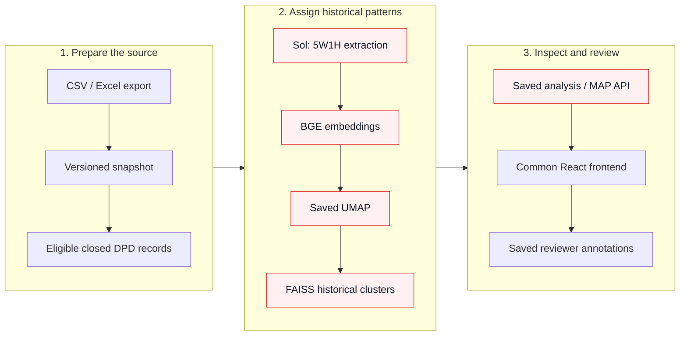

# CAPA.AI | MAP backend

**Find recurring patterns across historical deviations, then inspect the records behind each pattern.**

MAP is an independent FastAPI service. It reads an imported TrackWise export, extracts a consistent description of each event, and assigns records to existing historical clusters. The common React frontend uses its API to display clusters, original evidence and saved reviewer notes.

A deviation is a recorded departure from an expected process. CAPA means corrective and preventive action.

| At a glance | Details |
|---|---|
| Runtime | Python 3.11, 64-bit; FastAPI |
| Local API | http://127.0.0.1:8101 |
| Interactive API docs | http://127.0.0.1:8101/docs |
| Docker image | `capa-ai-map:local` |
| Browser interface | Separate [common frontend](https://github.com/rahul-jha-tfs/capa-ai-frontend) |

[Architecture](#how-map-works) / [Setup](#run-locally) / [API](#use-the-api) / [Storage](#data-and-saved-work) / [Troubleshooting](#troubleshooting) / [Deployment](#deployment)

## Where this fits

CAPA.AI has four independent repositories. They communicate through HTTP; the old combined platform is not needed.

| Repository | Responsibility | Port |
|---|---|---|
| **This repository: MAP** | Group deviations into recurring patterns | 8101 |
| [MATCH backend](https://github.com/rahul-jha-tfs/capa-ai-match-backend) | Search for similar historical records | 8102 |
| [AUTHOR backend](https://github.com/rahul-jha-tfs/capa-ai-author-backend) | Support investigation and CAPA drafting | 8103 |
| [Common frontend](https://github.com/rahul-jha-tfs/capa-ai-frontend) | Browser interface; currently connected to MAP | 8100 |

The prototype uses CSV/XLSX exports instead of live TrackWise connectivity. Each backend owns a copy of the source snapshot. Matching snapshot IDs confirm the same source version; this is not one shared live database or automatic synchronization between services.

## How MAP works



In plain terms, GPT describes what happened, BGE makes descriptions comparable, and the saved models place them into historical groups. Running an analysis does not retrain those models.

5W1H means who, what, when, where, why and how. By default, eligibility selects closed DPD deviations with a deviation root record and a populated Description; the imported source can contain many other records.

The retained configuration uses **`gpt-6.1-sol`, `medium` reasoning**, and exactly three extraction inputs: **Description, Investigation and Conclusion**. BGE remains `BAAI/bge-large-en-v1.5`, producing 1,024-value vectors before UMAP. Additional source fields are not extra extraction inputs in this version.

MAP also provides saved analysis history, progress/cancellation, downloadable results, cluster-summary review, source browsing and record annotations. Source sections, dates, criticality and explicit CAPA relationships remain available for inspection.

**Reading the results:** similarity measures closeness to a historical cluster, not the probability that an assignment is correct. Cluster membership alone does not establish root cause, severity or product impact. A reviewer note does not change an assignment or update TrackWise.

## Run locally

Run commands from **this repository's root** in PowerShell. Choose Docker or native Python for a given port.

### Already configured on this machine

```powershell
# Docker Desktop must have its Linux engine running.
.\Start-Docker.ps1
```

Or use the repo's native Python environment:

```powershell
.\Start-Map.ps1
```

Keep the terminal open. Visit [API docs](http://127.0.0.1:8101/docs); stop with **Ctrl+C**.

### First setup on a new machine: native Python

Install Git, Git LFS and **Python 3.11, 64-bit**, then:

```powershell
git lfs install
git clone -c core.longpaths=true https://github.com/rahul-jha-tfs/capa-ai-map-backend.git
cd capa-ai-map-backend
.\Setup-Map.ps1
```

Skip the clone steps if you already have the repository. **Setup pulls the source, BGE checkpoint/tokenizer and saved UMAP/FAISS bundle from this repository through Git LFS.** It verifies file sizes and SHA-256 checksums, creates `.venv`, installs pinned dependencies including the spaCy English model, creates `.env` if absent, and imports the bundled source on first setup. An existing source configuration and pinned dashboard run are preserved when setup is repeated without `-Source`.

On Windows, clone into a short location such as `C:\dev\capa-ai-map-backend`. The model cache has nested directories; on machines without Windows long-path support, a deeply nested checkout can exceed the path limit even when Git's long-path setting is enabled.

Another workbook can be supplied with `.\Setup-Map.ps1 -Source "C:\data\export.xlsx" -Sheet "Sheet1"`. Git LFS must be installed and able to access the repository. The initial runtime download is approximately 2 GB; later pulls reuse unchanged files. Do not use GitHub's **Download ZIP** as a substitute for the Git LFS checkout.

Before starting a new analysis:

1. Edit `.env` with your model endpoint and `OPENAI_API_KEY`. Import fills the source paths. Leave `MAP_DASHBOARD_RUN_ID` blank on a new installation until a completed run exists.
2. Run `.\Start-Map.ps1`, then create a small analysis through the API as shown below.

No separate model-file handover or Hugging Face download is needed. The default configuration loads the bundled BGE revision offline. [Runtime asset details](docs/RUNTIME_ASSETS.md) describe the included files and verification command; [third-party notices](THIRD_PARTY_NOTICES.md) retain model attribution.

**API keys, generated snapshots, saved analyses and reviewer notes are not included.** Setup creates the source snapshot locally. Complete an analysis before expecting the dashboard to show results; the existing local 40-record analysis is not shared through Git.

### First setup with Docker

Docker does not require host Python. Follow [DOCKER.md](DOCKER.md) to pull the same bundled assets with Git LFS, import the source in the container, and create `.env.docker` from [docker.env.example](docker.env.example). Container paths use `/data/...`; Windows `.env` paths cannot be copied unchanged.

After preparation, `Start-Docker.ps1` builds a missing image and starts MAP. Rebuild after code changes with:

```powershell
.\Start-Docker.ps1 -Build
```

The launcher mounts host `data` at `/data`; saved output survives container removal. Use `-Port 18101` if 8101 is occupied and point the frontend to that host port.

### Connect the frontend

Start MAP first. In a separate terminal, open the [frontend repo](https://github.com/rahul-jha-tfs/capa-ai-frontend):

```powershell
npm ci
npm run build
npm run start
```

Open http://127.0.0.1:8100/map. The frontend defaults to MAP on port 8101, including when MAP runs in Docker. MATCH and AUTHOR are not required for MAP screens.

## Configuration

Native Python reads `.env`; Docker reads `.env.docker`. Both are ignored local files. Templates contain configuration names, not credentials.

| Setting | Purpose |
|---|---|
| `CAPA_SOURCE_SNAPSHOT`, `CAPA_SOURCE_CSV` | Imported SQLite snapshot and its matching CSV export |
| `CAPA_DATA_DIR` | Writable root for analysis output and review history |
| `MAP_ASSETS_DIR` | Trusted UMAP/FAISS bundle |
| `HF_HOME` | Hugging Face cache containing BGE |
| `OPENAI_MODEL`, `OPENAI_REASONING_EFFORT` | Retained settings: `gpt-6.1-sol`, `medium` |
| `OPENAI_BASE_URL`, `OPENAI_API_KEY` | Model endpoint and credential; Azure transport is also supported through its endpoint/version settings |
| `MAP_DASHBOARD_RUN_ID` | Optional completed run to display; blank selects the latest completed historical analysis |

Viewing a saved result requires no new model call. Extraction and live summary generation send narrative text to the configured endpoint and consume its API allowance.

## Use the API

Open `/docs` for schemas and **Try it out**. The machine-readable schema is `/openapi.json`.

Create a small analysis using normal live summaries:

```powershell
$body = @{ limit = 5; summary_mode = "live" } | ConvertTo-Json
$run = Invoke-RestMethod -Method Post `
  -Uri "http://127.0.0.1:8101/api/v1/map/runs" `
  -ContentType "application/json" -Body $body

Invoke-RestMethod "http://127.0.0.1:8101/api/v1/map/runs/$($run.run_id)"
```

Poll until `completed`, then inspect that run's `/dataset`, `/results` or download. `limit: 0` selects all eligible records; use a small selection when checking a new setup. Failed runs retain status and a worker log.

**Complete API inventory: 21 method-and-path operations, checked against this service's generated OpenAPI schema.** Each row links to its request parameters, response, saved changes and errors in the [detailed API reference](docs/API.md). GET and POST on the same URL count separately.

### Service and source APIs

| Method and path | Function |
|---|---|
| [`GET /api/v1/map/health`](docs/API.md#get-api-v1-map-health) | Check that the API process responds. |
| [`GET /api/v1/map/ready`](docs/API.md#get-api-v1-map-ready) | Check that the configured source snapshot is available. |
| [`GET /api/v1/map/source`](docs/API.md#get-api-v1-map-source) | Inspect which source export this instance uses. |
| [`GET /api/v1/map/source/quarantine`](docs/API.md#get-api-v1-map-source-quarantine) | Inspect source rows held aside during import, for example duplicate IDs. |
| [`GET /api/v1/map/records`](docs/API.md#get-api-v1-map-records) | Browse accepted records in the imported source. |
| [`GET /api/v1/map/records/{pr_id}`](docs/API.md#get-api-v1-map-records-pr-id) | Open an accepted source record by its original PR ID. |

### Analysis APIs

| Method and path | Function |
|---|---|
| [`GET /api/v1/map/options`](docs/API.md#get-api-v1-map-options) | Discover run defaults, limits and supported choices before building a form. |
| [`GET /api/v1/map/runs/legacy-catalog`](docs/API.md#get-api-v1-map-runs-legacy-catalog) | List retained validation runs that can be imported. |
| [`POST /api/v1/map/runs/import-legacy`](docs/API.md#post-api-v1-map-runs-import-legacy) | Copy retained validation artifacts into this service's run history. |
| [`GET /api/v1/map/runs`](docs/API.md#get-api-v1-map-runs) | List the most recent analyses. |
| [`POST /api/v1/map/runs`](docs/API.md#post-api-v1-map-runs) | Queue a new extraction and clustering analysis. |
| [`GET /api/v1/map/runs/{run_id}`](docs/API.md#get-api-v1-map-runs-run-id) | Poll one analysis and inspect progress or failure details. |
| [`POST /api/v1/map/runs/{run_id}/cancel`](docs/API.md#post-api-v1-map-runs-run-id-cancel) | Stop a queued or running analysis. |

### Read results and downloads

| Method and path | Function |
|---|---|
| [`GET /api/v1/map/runs/{run_id}/results`](docs/API.md#get-api-v1-map-runs-run-id-results) | Inspect analysis records, cluster summaries and diagnostics. |
| [`GET /api/v1/map/runs/{run_id}/explorer`](docs/API.md#get-api-v1-map-runs-run-id-explorer) | Read the same explorer result through its alternate route. |
| [`GET /api/v1/map/runs/{run_id}/dataset`](docs/API.md#get-api-v1-map-runs-run-id-dataset) | Load one completed analysis in the frontend presentation format. |
| [`GET /map/dataset`](docs/API.md#get-map-dataset) | Load the analysis selected for the current MAP dashboard. |
| [`GET /api/v1/map/runs/{run_id}/download`](docs/API.md#get-api-v1-map-runs-run-id-download) | Download a retained artifact selected by kind. |

### Save reviews

| Method and path | Function |
|---|---|
| [`POST /api/v1/map/runs/{run_id}/review`](docs/API.md#post-api-v1-map-runs-run-id-review) | Save cluster-summary review decisions for a completed run. |
| [`GET /api/v1/map/runs/{run_id}/annotations`](docs/API.md#get-api-v1-map-runs-run-id-annotations) | Read saved record-level reviewer assessments and notes. |
| [`PUT /api/v1/map/runs/{run_id}/records/{record_id}/annotation`](docs/API.md#put-api-v1-map-runs-run-id-records-record-id-annotation) | Save one record's assessment/note with revision checking. |

Annotation writes contain `assessment`, `note` and `expected_revision`; zero means no prior annotation. HTTP **409** rejects a stale revision. Reload before retrying. Record annotations are separate from cluster-summary approvals.

The dataset's `sourceSections` contains explicit `{key, label, text}` entries. Clients can preserve original field boundaries without guessing from headings within the narrative.

## Data and saved work

The reference workstation has **19,643 accepted source records**; its pinned dashboard shows **40 analysed records in 18 clusters**. These are local coverage figures, not application limits or saved results supplied by a clone. See [source provenance](data/sources/README.md).

| Location | Contents | In Git? |
|---|---|---|
| `data/sources/trackwise_records.csv` | Named source export | Yes, Git LFS |
| `data/sources/<snapshot-id>.sqlite3` and `.csv` | Imported source version and matching export | No |
| `data/assets/`, pinned BGE files under `data/models/` | Clustering bundle, reference files and exact BGE revision | Yes; large files use Git LFS |
| `data/map-runs/<run-id>/` | Request, progress, extraction, assignments, summaries, validation and logs | No |
| Run folder's `record_annotations.json` | Notes, revisions and annotation history | No |

Persist and back up complete run folders with the source versions needed to interpret them. Old analyses remain tied to their original source identity when new data is imported.

## Find your way around

```text
src/capa_map/              FastAPI routes and service-owned application logic
  application/            Runs, dataset assembly and record annotations
  infrastructure/         Source import, storage and HTTP boundary
src/map_core/             Retained extraction, embedding and clustering logic
src/map_pipeline.py       Pipeline stage orchestration
src/run_map.py            Persisted-model compatibility/parity helpers
tests/                    Offline contracts and runtime checks
Start-Map.ps1             Native launcher
Start-Docker.ps1          Independent Docker launcher
```

## Verify your setup

```powershell
.\.venv\Scripts\python.exe -m pytest -q
.\.venv\Scripts\python.exe -m pip check
Invoke-RestMethod "http://127.0.0.1:8101/api/v1/map/ready"
```

For Docker, use `docker logs capa-ai-map` and the checks in [DOCKER.md](DOCKER.md). A healthy API alone does not establish model readiness; complete a small analysis too.

[VERIFICATION.md](VERIFICATION.md) records actual checks and their limits: Linux execution, persistence, frontend connectivity and agreement with the existing 500-record native baseline. Compatibility checks are not an independent accuracy evaluation.

## Troubleshooting

| Symptom | Check |
|---|---|
| Source unavailable / HTTP 503 | Import the CSV; verify both source paths in the host/container environment |
| No dataset / completed analysis | Finish a run; check `MAP_DASHBOARD_RUN_ID` references an available completed run or is blank |
| Offline model cannot load | Run `git lfs pull`, then `.venv\Scripts\python.exe -m capa_map.bootstrap`; verify `HF_HOME` and `MAP_ASSETS_DIR` point to this checkout's data |
| Model endpoint error | Set an actual endpoint, model and key; blank `OPENAI_BASE_URL` is not a working MAP configuration |
| Frontend cannot reach MAP | Check port 8101 and the frontend's `MAP_API_TARGET` |
| CSV is an LFS pointer | Run `git lfs pull` before import |
| Port occupied | Stop the other instance or use `Start-Docker.ps1 -Port 18101` and update the frontend target |

## Deployment

[DOCKER.md](DOCKER.md) covers the independent image, mounted data and checks. [DEPLOYMENT.md](DEPLOYMENT.md) describes the separate Databricks Apps source-deployment path through `app.yaml`.

Local Docker execution is verified. Databricks still needs persistent source/model/run storage, secrets, frontend-to-backend authentication and target-environment acceptance checks. The current worker/file-lock design serves a single instance; horizontal scaling requires external job coordination and shared durable state.
